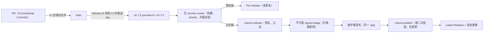

# 发布流程

所有应用代码以 `main` 为集成主线，各平台独立构建和验收。从 1.1.6 开始，正式 `v*` 发布统一构建
macOS、Windows、Android、Linux 安装包并附在同一 GitHub Release；iOS 独立走 App Store 审核。
分支与本地维护方式见 [docs/development/maintenance.md](../development/maintenance.md)。本地合入 `main` 不会触发远端构建，
也不等于批准推送、创建 tag、安装或发布。下文的 `release.sh` 和签名包流程主要面向 macOS。

**合并到 main → 五端远端 CI 全绿 → `./scripts/release.sh stable` → tag → 构建、签名与安装验证 → 受保护发布 → 四端安装包读回校验 → 更新清单。**

产品构建、自动测试和发布包验收在远端 CI 执行；本机安装或真实设备验收需按维护规范明确授权，记录实际覆盖范围。
签名、安装器测试和公开资产读回必须成功，不能把“发起安装”写成“更新完成”。

## 设置内应用更新

五端均从设置进入应用更新。macOS 下载并验证签名、公证的 PKG，由系统 Installer 安装；Windows 下载
校验后的完整 EXE；Android 校验 APK 包名、版本及长期签名，交给系统确认安装；Linux 当前支持
Ubuntu 24.04 / 26.04 amd64，通过 polkit 授权系统包管理器安装 DEB。安装保留现有用户数据，所需的注销或重启
由页面和系统安装器提示。完成状态以重新运行的版本核对为准。

iOS 查询实际可用的 App Store 版本，跳转商店下载和安装；TestFlight 包另有测试渠道入口。
GitHub Release 出现新版本不表示该 iOS 版本已经获批或上架。

`update-manifest.json` 是四端共同更新入口，包含版本、源码提交、包地址、大小、SHA-256、架构和系统要求。
CI 先上传并读回所有安装包，最后才上传并读回清单。失败时不能发布缺少某个平台的清单，也不覆盖
已有不同字节的资产。旧 macOS 客户端使用的 `RIMES-X.Y.Z.pkg` 文件名保持兼容。

若已通过受保护发布的正式 Release 因后续任务跳过或失败，缺少 Android／Windows 包或完整清单，
可在 main 手动运行 `Complete approved release assets`，输入原 tag 工作流的 run ID。
恢复流程逐项要求原签名、同包安装、四端构建及 macOS／Linux 发布任务成功，核验原 tag／commit、
不可变 Artifact 的来源与压缩包 SHA-256，然后使用同一发布脚本补齐资产、逐个下载比对，最后发布清单。
它不创建 Release、不重签、不覆盖不同字节的资产、不接受 PR／预览／取消的源流程，也不改变环境保护。
正常正式发布显式要求所有生产任务成功，避免预览分支的预期跳过向清单任务传播。

macOS 的 `VERSION`、`Info.plist` 与正式 tag 必须一致。发布脚本不修改、不提交任何文件，只在 `origin/main` 上创建并推送一个 tag；
构建、验证、发布说明和 Release 由 GitHub Actions 完成。macOS 与数据预览的发布中心是
[`scholay/xsime`](https://github.com/scholay/xsime/releases)；iOS 独立走 App Store Connect。



## 渠道

| 渠道 | tag | 命令 | 产物 | 用户如何升级 |
|---|---|---|---|---|
| macOS 预览版 | `vX.Y.Z-preview.N` | `./scripts/release.sh preview` | 未签名 PKG + `SHA256SUMS`，Pre-release | 手动安装，见 [docs/release/unsigned-preview.md](unsigned-preview.md) |
| macOS 正式版 | `vX.Y.Z` | `./scripts/release.sh stable` | Developer ID 签名并公证的 PKG + `SHA256SUMS`，Latest | 应用内自动更新 |
| iOS | `ios-vX.Y.Z`（App Store 工作流） | [iOS 发布流程](../platforms/ios/release.md) | App Store 签名 IPA、独立 build number；当前公开测试使用 TestFlight | TestFlight / App Store，分别记录审核状态 |
| Android | 同项目 `vX.Y.Z` | 远端 Android checks 与 android-release 环境 | 原长期密钥签名 APK / AAB | 设置内下载 APK，系统确认后保留数据升级 |
| Windows 原生 | 同项目 `vX.Y.Z` | [Windows 构建](../../platforms/windows/native/README.md) | x64 / x86 完整载荷、EXE 安装器与 ZIP；当前 EXE 未签名 | 设置内下载 EXE 并安装，按提示重启或注销 |
| Linux 原生 | 同项目 `vX.Y.Z` / `vX.Y.Z-preview.N` | [Linux 安装与打包](../../platforms/linux/ime/README.md) | 同一 Release 的 `fcitx5-rimes_<version>_amd64.deb` 与 `.sha256` | Ubuntu 24.04 amd64 设置内下载并授权安装 |
| Windows / Linux 数据预览（维护通道） | `platform-preview-vX.Y.Z` | `./scripts/release.sh platform minor` | 数据与脚本包，Pre-release | 手动安装，见 [docs/release/platform-preview.md](platform-preview.md) |

> GitHub required checks 不变。各端 PR 检查按相关路径触发；每次 main 推送运行五端检查，
> 让正式版门禁始终能校验将要打标签的确切 main 提交，避免只改某一端后缺少其他端的检查记录。
> 旧数据预览与 Windows Foundation 保留每周/手动检查。`v*` 的发布工作流另外要求本次 Linux deb
> 构建与安装／升级／重装／卸载测试成功后才公开 Release。真实桌面验收须单独记录。

> Developer Program 资格或一张 Developer ID 证书本身不能把预览版变成正式版。每次正式
> `vX.Y.Z` 发布必须同时具备同一 Team 的 **Developer ID Application + Developer ID Installer** 证书及私钥、
> 受保护的 `macos-release`（签名与公证）和 `macos-publish`（第二次发布批准、无密钥）Environment，
> 以及 App Store Connect 公证凭据；任一缺失都会 fail-closed。
> 未通过正式签名、公证和发布验证的包只能进入对应预览渠道，不能标记为 Latest。
> 完整清单见[发布环境与凭据](reference.md#release-environment)。

## 一、日常节奏

1. **一个 PR 只做一件事。** 提交信息使用 [Conventional Commits](https://www.conventionalcommits.org/zh-hans/v1.0.0/)：
   `feat(scope): …`、`fix: …`、`perf:`、`refactor:`、`docs:`、`test:`、`build:`、`ci:`、`chore:`、`style:`、`revert:`。
   发布说明由提交信息生成，CI 的「Release tooling」会拒绝不合规的提交。
2. **不直接推送 main。** main 受 ruleset 保护：合并必须经过 PR，且必需的 macOS CI 检查通过。
3. **按平台整理用户可见变更。** 合并代码不自动创建版本；Linux 在下次项目 `v*` 发布时同步 deb，
   并检查其安装、升级、卸载说明与依赖兼容性。实际发布仍需维护者授权。
4. 一条预览线经过真机验证后，只有完整的正式发布前提都满足时才能用 `stable` 转正；Developer ID
   可用并不单独构成发布授权。

## 二、发布一个版本

```bash
git switch main && git pull --ff-only
./scripts/release.sh --dry-run preview   # 查看版本号、门禁结果和发布说明
./scripts/release.sh preview             # 确认后推送 tag
```

| 命令 | 结果 |
|---|---|
| `preview` | 继续进行中的预览线：`v0.5.0-preview.1` → `v0.5.0-preview.2` |
| `preview patch\|minor\|major` | 从最新正式版升级，开始新预览线的 `preview.1` |
| `preview X.Y.Z` | 开始指定的预览线；低于进行中的预览线会被拒绝 |
| `stable` | 把进行中的预览线转正：`v0.5.0-preview.N` → `v0.5.0` |
| `patch\|minor\|major` 或 `X.Y.Z` | 直接发布正式版 |
| `platform patch\|minor\|major\|X.Y.Z` | Windows / Linux 维护预览；不构成 macOS 发布门禁 |

脚本在推送前逐项检查，任何一项不满足都会拒绝（`--dry-run` 只报告）：

- `origin` 的 fetch / push 地址都指向 `scholay/xsime`；
- 当前在 `main`，工作区干净，`HEAD` 等于 `origin/main`；
- `origin/main` 这个提交的 `CI` 已通过（其中包含 macOS build/runtime smoke 与发布工具校验）；
- 正式版还要求同一提交的 iOS checks、Android checks、Windows IME、Linux IME 全部通过；预览版维持原有门禁；
- 新 tag 不存在，并高于同渠道已发布的版本；
- `Info.plist` 版本仍是占位值，预置插件 catalog 已同步；
- 正式版还要求 `macos-release` 与 `macos-publish` 都存在；二者都要有非空 required reviewers、禁止
  administrator bypass，并以 selected branch/tag policy 允许 `v*`。前者的受保护 job 要求
  Application / Installer 两份证书、同一 Team ID 与公证凭据完整可用，后者不得存放这些凭据。

两个 Environment 表示两次批准，**不要求两名审核者**；同一个 reviewer 可以先批准签名，再在同一安装包的
真机验收通过后批准公开。当前由 `scholay` 发起并分别审核两次，允许 self-review；仍必须通过审批门，
不能以管理员身份跳过审批。以后需要独立复核时，可以另行启用 prevent self-review 并指定其他审核者。

此外，独立的 `release tag creation` ruleset 对 `refs/tags/v*` 施加 **creation** 限制，只允许指定的
发布账号 `scholay` 创建标签。原有 `release tags` ruleset 仍无 bypass，禁止所有人删除或移动已有标签；
不要把创建标签的例外权限加到不可变规则上。工作流会在导入凭据和创建 Release 前
再次读取两个 Environment，配置变弱或缺失就拒绝继续；不要用直接 `git push` 绕开 `release.sh`。

## 三、tag 推送之后

**正式 tag 创建后，到对应 Release 完成公开前，暂停合并任何 main PR，包括纯文档 PR。**
签名 job 在导入凭据前会重新校验 `origin/main` 与 tag 源提交完全一致；构建期间推进 main，
即使只改文档，也会使这道检查拒绝继续。发布记录和生成的 `CHANGELOG.md` 应在公开资产读回校验后，
再通过后续 PR 合入。不要通过移动 tag、回退 main 或放宽保护规则恢复流程。

[`.github/workflows/release.yml`](../../.github/workflows/release.yml) 接手：

1. **构建**（无 secrets 的 runner）：把 tag 版本写入 `CFBundleShortVersionString`、run number 写入
   `CFBundleVersion`；arm64 与 x86_64 分别构建后用 `lipo` 合并为通用二进制；组装 `RIMES.app` 并执行
   runtime smoke。
2. **预览版**：打未签名 PKG；在一次性 runner 上先安装**最新已发布的 Release**，再安装新包，验证旧 bundle
   已被退役、回执、签名与架构；随后另一台无 secrets 的 runner 被动复核字节并创建 Pre-release。
3. **正式版签名与暂存**：全新 runner 进入受保护的 `macos-release`，以 Developer ID Application 签 app、
   以 Developer ID Installer 签精确 `RIMES-X.Y.Z.pkg`，只公证并校验这个用户实际接收的最终 PKG；它销毁
   keychain / P8 后才上传不可变的 four-file signed-stage（pkg、`SHA256SUMS`、说明、manifest）。
4. **维护者同路验收与发布**：维护者下载 staged pkg，先验证后用 macOS Installer 真实安装；只有验收通过才批准
   无密钥的 `macos-publish`。它核验 artifact ID/digest、manifest 与逐文件 SHA-256，绝不重签、重打包或
   重公证，然后以完全相同的字节创建 Latest，并下载公开资产再次读回校验。
5. **发布说明** = 安装与校验说明 + 自动生成的「变更」：自上一个**公开 GitHub macOS Release**以来的提交
   按类型分组，列出合并的 PR 和完整对比链接。取消或未公开的 tag 绝不作为比较基线。
6. **Linux deb**：`linux-deb.yml` 在 Ubuntu 24.04 amd64 构建同一提交，运行原生测试与 deb 新装／升级／重装／
   卸载验证，每步比对用户数据内容、权限、所有者及目录结构，新装和升级后均执行安装后二进制检查。
   优先从已公开项目 `v*` Release 选择低于本次版本且架构相同的最新 deb，验证摘要及包身份后升级。
   首次没有历史 deb 时明确使用当前载荷生成的旧版本夹具，并检查旧文件退役；这不代表历史应用数据迁移通过。
   API、下载或校验失败必须使验收失败，不能伪装成“没有旧包”。所有 Linux 模块变化都触发发布演练。
   Release 公开须等待此 job 成功。随后只向已公开的同名 `v*` Release 附加 deb 与其 `.sha256`，
   再下载读回比对，重试只接受相同字节，不覆盖资产。预览版本映射为 `X.Y.Z~preview.N`，正式版本必须与
   根 `VERSION` 一致。每次发布同步 Linux 变更与安装文档；完整验收另需 X11/Wayland 实际输入测试。

工作流失败时**不要删除 tag 重来**：修复后发布下一个版本号。tag、资产与 SHA-256 一经发布即不可变，
ruleset 必须禁止删除或移动 `v*` 与 `platform-preview-v*` tag；正式 `v*` 还必须限制创建权限。

## 四、发布前演练

`Release macOS` 工作流在以下情况以演练模式运行完整的构建、打包和升级安装，**不发布**，产物保留 7 天：

- 修改打包相关文件的 PR（`Package.swift` / `Package.resolved`、`Info.plist`、`Resources/`、`rime-data/`、
  `scripts/pkg/`、发布脚本与工作流等）；
- 每天 03:17（北京时间）对 main 的定时运行；
- 在 Actions 页面手动运行（可指定版本号）。

演练默认使用下一次 `release.sh preview` 会得到的版本号，所以演练通过就等于下一个预览版的构建已经过一遍。

## 五、维护者安装通道与正式包一致性

开发维护与正式包验证是两条**互斥**的安装通道；同一用户或正式包测试机一次只选其一。

- **开发维护通道**：`build_install.sh` 面向 checkout 中的当前源码，安装当前用户开发版。它的版本随
  `git describe` 变化；即使本地 smoke 通过，也不能证明正式发布资产。
- **正式包通道**：用户只使用 GitHub 正式 Release 中的精确 `RIMES-X.Y.Z.pkg` 与 `SHA256SUMS`，由
  Installer 安装到 `/Library/Input Methods`。发布前的维护者只可使用签名 job 已清理密钥后生成的 immutable
  signed-stage，不能用本地重打包或普通演练 Artifact 替代它；正式安装器会在能安全核验时退休当前 GUI 用户的
  开发版，因此两条路径不能并存或互相覆盖。

发布工作流会在签名 runner 上被动校验已经签名、公证和 staple 的正式资产，但这不替代维护者的
发布一致性测试。signed-stage 出现后，维护者应运行：

```bash
scripts/rehearse-release-pkg.sh --pkg /absolute/path/RIMES-X.Y.Z.pkg
scripts/rehearse-release-pkg.sh --pkg /absolute/path/RIMES-X.Y.Z.pkg --install-gui
```

第一个命令不安装；第二个命令打开用户也会看到的 Installer，并在安装完成后复核输入源、签名、公证和回执。
脚本等待更新后的 PackageKit 回执，最多 15 分钟，不要求退出 Installer；若取消安装，可按 Ctrl-C 结束验收等待。
通过后记录 tag、资产 SHA-256、macOS 版本和测试设备，再批准 `macos-publish`。公开后 workflow 还会下载正式
Release 的同一批资产读回校验。signed-stage 只是一道发布权威门：GitHub Actions artifact 的访问规则不等于发布
禁运，面向用户的唯一来源始终是 GitHub Release。

## 六、版本号规则

- **VERSION 是产品目标，tag 是发布身份。** `Info.plist` 与 `VERSION` 必须一致；正式 tag 也必须匹配。
  `stable` 默认选择该目标。开发安装使用 `1.0.0-dev.<commit>[.dirty]`，继续退出正式自动更新通道。
- 排序：`X.Y.Z-preview.N` 低于 `X.Y.Z`；预览号从 1 开始递增，禁止回退。
- 应用内更新只认严格的 `X.Y.Z`；预览版和开发版不会收到更新提示。

## 七、更新日志

每个 Release 的正文都带有变更列表。[`CHANGELOG.md`](../../CHANGELOG.md) 由
`python3 scripts/release/release_tool.py changelog --write` 从公开 GitHub Release 与提交历史生成：发布后在下一个
PR 里顺手更新，CI 在它落后或公开记录无法读取时会给出警告。

## 八、分发边界

正式包、预览包和第三方分发渠道分别验证。应用内更新使用前述已校验的正式资产；预览版不进入正式更新清单。新增 Homebrew 等渠道时，需要单独维护包身份、签名、公证和升级验证，不能通过要求用户绕过系统保护来替代。

## 相关文档

- [docs/release/reference.md](reference.md)：三段式签名/暂存/发布设计、Environment 与 Secrets、自包含 librime、
  安装器、应用内更新、CI、跨平台预览。
- [docs/release/unsigned-preview.md](unsigned-preview.md)：面向用户的预览版下载、校验与安装说明。
- [docs/release/platform-preview.md](platform-preview.md)：Windows / Linux 数据预览的能力边界。
